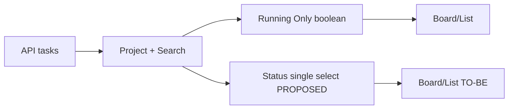

## 專案清單（Projects）
| P# | Root | 角色 | 範圍 | 狀態 |
|---|---|---|---|---|
| P1 | ai-task-runner/ | Tasks UI 與測試 | ui/static、ui/tests | CONFIRMED |
## 變更影響總覽
| 專案 | 主要變更 | 影響既有功能/流程 | 相容性/注意事項 | 風險 |
|---|---|---|---|---|
| P1 | 取代 Running Only UI，擴充 visibleTasks | Board/List、搜尋、Project、輪詢 | 不改 API、Task schema、drag/drop、CRUD、Run、worktree | 中 |
## As-Is / To-Be

## 檔案規劃及 LOC 估計
### ai-task-runner
| F# | 檔案 | 動作 | 預計改什麼 | 影響/原因 | +LOC | -LOC | R# |
|---|---|---|---|---|---:|---:|---|
| F1 | ui/static/js/tasks-board.js | 修改 | 以 statusFilter 取代 runningOnly，新增明確分類 predicate；沿用 visibleTasks/render/refresh；mount 單選事件，移除舊切換 | 不碰 API/拖移；同一篩選用於 Board/List | 25–45 | 8–18 | R1–R6 |
| F2 | Tasks HTML 模板（UNVERIFIED：需在 ui/static 內定位 tasksRunningFilterButton 所屬檔） | 修改 | 以可存取的單選元件取代舊按鈕，保留 tasksRunningCount | 版面/鍵盤相容 | 8–20 | 2–8 | R1,R4 |
| F3 | ui/static/css/tasks-board.css | 修改 | 新控制元件樣式、active/focus/窄螢幕規則 | 不破壞現有工具列 | 8–25 | 0–4 | R1,R4 |
| F4 | ui/tests/test_browser_crud_e2e.py | 修改 | Browser E2E 測四選一、搜尋交集、輪詢與 CRUD/Run/Worktree | 防止回歸 | 65–130 | 0 | R1–R6 |
| F5 | ui/tests/test_feature_task_ui_parity.py | 修改（視既有斷言） | 更新舊 Running Only selector/assertion，保留原有 UI parity | 防舊測試假陰性 | 10–30 | 0–8 | R1,R4 |
Production 小計 +41–90/-10–30 LOC；Test 小計 +75–160/-0–8 LOC；總計 +116–250/-10–38 LOC（估計，F2 路徑 UNVERIFIED）。
### 關鍵實作草圖（F1/R2,R3,R5）
```text
statusFilter = "all"  // per-page state
classify(task):
  if task.status == "paused" and task.run.phase in KNOWN_TERMINAL_FAILURE_PHASES: return "failed"
  if task.status == "ongoing": return "running"
  if task.status == "closed": return "completed"
  return "other"
visibleTasks(): tasks.filter(projectMatch && searchMatch && (statusFilter=="all" || classify(task)==statusFilter))
onFilterChange(next): statusFilter=next; render() // no fetch
onExistingRefresh(): replace tasks snapshot; render() // preserve statusFilter
```
## Interface / Contract Changes
無對外 Interface / Contract 變更。內部前端 filter state 從 boolean 換成 enum all/running/completed/failed（PROPOSED）；後端生命週期 new/ongoing/paused/closed 保持不變。run.phase=launch_failed、recovery_launch_failed 為已查證現有值。
## Function Call Flow
```mermaid
sequenceDiagram
participant User
participant Board as tasks-board.js
participant API as /api/tasks
User->>Board: 選 Failed (PROPOSED)
Board->>Board: 更新 statusFilter; render()
Note over Board: 不呼叫 API
Board->>API: 既有 refresh() 週期
API-->>Board: tasks snapshot
Board->>Board: visibleTasks() + render()
```
## DB／儲存變更
無 DB 或 persisted-schema 變更；不寫入 localStorage，重載回 All。現有 Project 篩選 localStorage key 保留。
## 技術風險與注意事項
- Failure phase 可能擴充：僅納入已確認終止失敗狀態，不用任意 error 欄位推測。
- 背景 refresh 會重建列 DOM；篩選控制不應在 render 中重建而失焦。
- 刪除或狀態轉換使目前篩選為空時仍應保留選項。
- 不可改動 boardMoveRule、moveTask、TaskService、TaskRunService。
