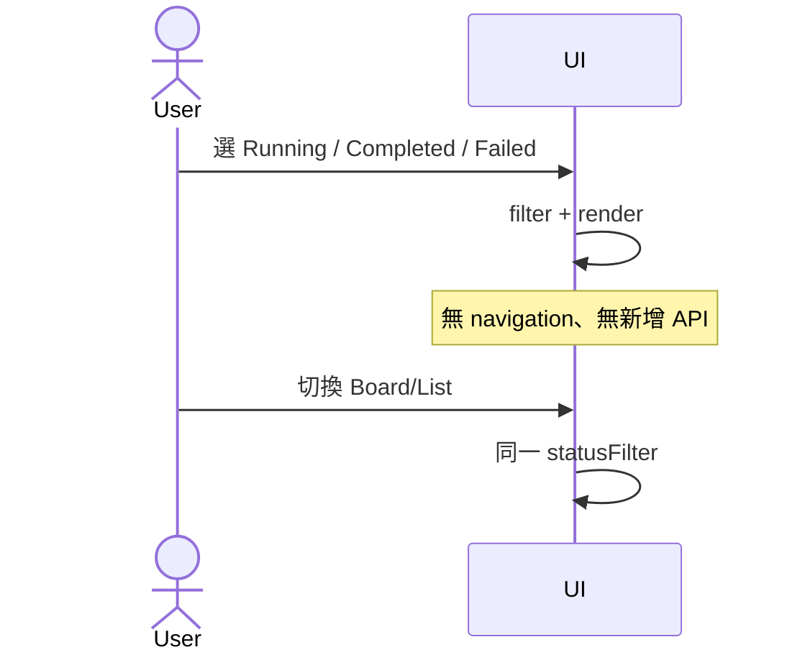
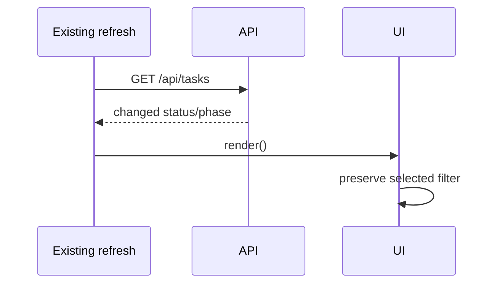
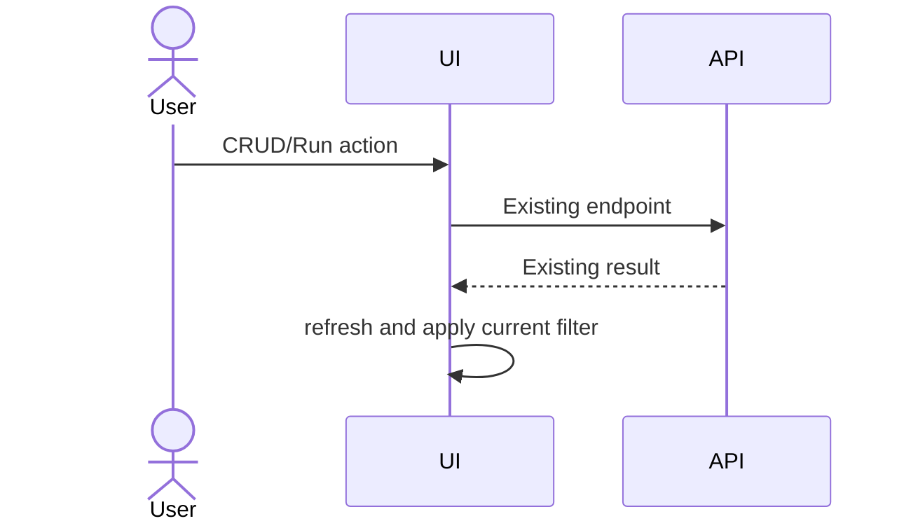
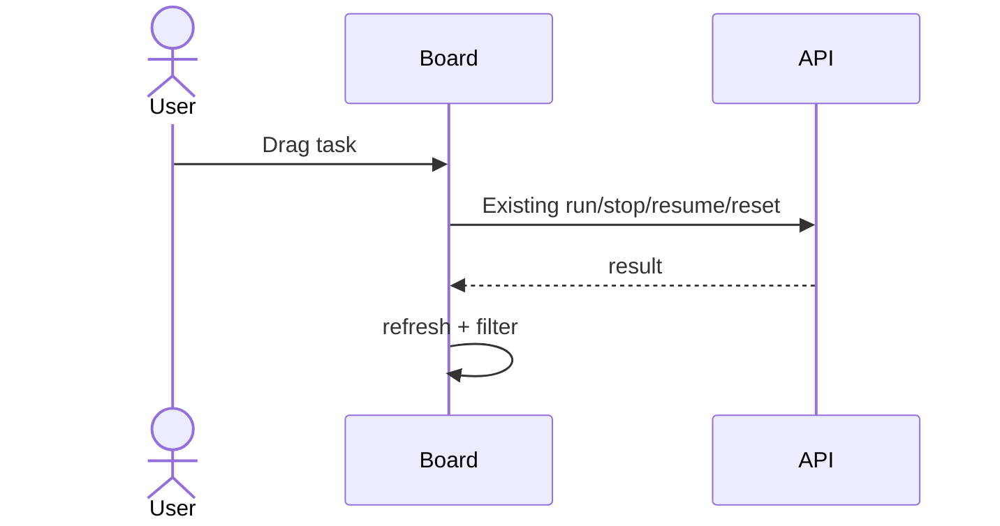

## 必看 E2E 情境
| E# | 情境 | 預期可觀察結果 | 重要性 | 覆蓋 R# | Regression? |
|---|---|---|---|---|---|
| E1 | All→Running→Completed→Failed→All，切換 Board/List | 同步立即更新，無頁面 reload、無額外 API | 必看 | R1–R4 | 是 |
| E2 | running→closed、launch_failed→paused 的既有 refresh | 保留選項、下一次 refresh 更新可見列 | 必看 | R3,R5 | 是 |
| E3 | 篩選啟用時新增/編輯/刪除/執行/停止/恢復/重設 | 功能不變，篩選不造成資料遺失或事件失效 | 必看 | R6 | 是 |
| E4 | Worktree Task 及拖移 | 原本動作仍可用，未改變後端狀態 | 必看 | R6 | 是 |
| E5 | Project + Search + status 交集、空結果 | 只顯示符合全部條件的項目，空狀態正確 | 一般 | R2,R4 | 是 |
## E1
前置：準備 new/ongoing/closed/paused 與 paused+launch_failed 測試資料；Board/List 可切換。步驟：逐項選擇四種狀態，切換兩種 view；監控 page navigation 與 /api/tasks 次數。Assert：Running=ongoing；Completed=closed；Failed=paused+launch_failed；正常 paused 僅 All；Running 徽章保持搜尋/Project scoped 數量。證據：Playwright DOM assertions、network request log。Cleanup：刪除 fixture。

## E2
前置：已選 Running 或 Failed，mock API 可變更 Task snapshot。步驟：透過現有 refresh/poll 入口更新 running→closed、paused→launch_failed；Assert：原篩選仍選中、列表隨 snapshot 更新、不會被當成手動暫停；若 refresh 失敗沿用既有錯誤處理。證據：Playwright 與 API mock trace。Cleanup：還原 mock。

## E3
前置：有新建、可編輯、可刪除、可執行 Task。步驟：篩選啟用後透過現有 UI 完成 CRUD、run/stop/resume/reset，檢查 API payload 與持久化結果；Assert：原功能與錯誤提示保持，Task 進出篩選時無資料遺失。證據：E2E response/assertion。Cleanup：測試資料。

## E4
前置：具備 worktree 與可移動 Task。步驟：從 Board 拖移、啟動 worktree 任務，切換 filter/view；Assert：drag/drop、工作目錄操作與原錯誤策略不變。證據：E2E、現有 worktree tests。Cleanup：清理 worktree fixture。

## Integration
- I1 (R1–R5/P1/F1,F2)：Tasks DOM 與 API mock、兩個 view 同步，PLANNED。
- I2 (R6/P1/F1,F4)：現有 CRUD/Run/Worktree E2E regression，PLANNED。
## Unit
- U1 (R3/P1/F1)：明確分類矩陣：new、ongoing、closed、paused、paused+launch_failed、paused+recovery_launch_failed、paused+普通錯誤、ongoing+recover，PLANNED。
- U2 (R2,R4/P1/F1)：Project/Search/Status 三條件交集與 Running badge 計數，PLANNED。
- U3 (R5/P1/F1)：切換無 API、refresh 保留選項、過期 refresh token 不覆蓋新資料，PLANNED。
## 執行狀態
全部 PLANNED；此階段不跑測試，不宣稱 PASS。
