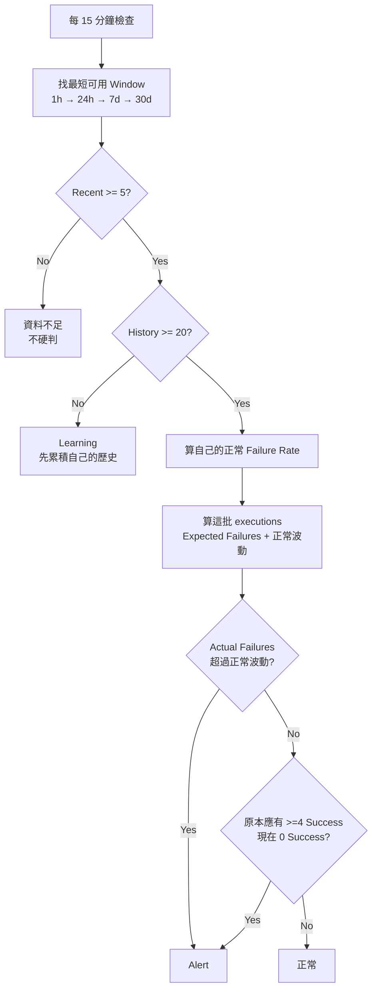

# 通用積木 Failure Alert v11

> **目標：簡單 + 低誤判 + 大部分真正異常抓得到**
>
> 本版所有情境與大量組合都已用 Python 實際跑過。
>
> - Deterministic：**14/14 PASS**
> - 正常資料平均誤判：**0.456%**
> - 正常資料誤判中位數：**0.233%**
> - 最差單一測試格：**2.967%**
>
> 完整數字見 `simulation_summary.md`。

---

# Summary

## 1. 核心概念

不使用通用固定 Failure Rate：

```text
failure > 10%
failure > 30%
```

因為某些積木：

```text
正常 failure 就可能 90%
```

真正要判斷的是：

> **現在的 Failure 數，是否明顯超過這顆積木自己的歷史預期？**

---

## 2. 判斷流程



---

## 3. Window

```text
1h >= 20 executions    → 用 1h
否則 24h >= 20        → 用 24h
否則 7d >= 20         → 用 7d
否則 30d >= 5         → 用 30d
否則                   → 資料不足
```

因此 3~4 天才一筆：

```text
30 天大約 7~10 筆
```

仍可以進入判斷。

---

# 規則

## 4. 正常 Failure Rate

```text
p =
(history_fail + 1)
/
(history_exec + 2)
```

PromQL 概念：

```promql
(block:history_failure + 1)
/
(block:history_execution + 2)
```

---

## 5. Expected Failure

```text
expected_fail = recent_exec * p
```

PromQL：

```promql
block:recent_execution
*
block:normal_failure_rate
```

---

## 6. 正常波動

```text
variance =
recent_exec * p * (1-p)
+
recent_exec² * p * (1-p) / history_exec
```

PromQL：

```promql
(
  block:recent_execution
  * block:normal_failure_rate
  * (1 - block:normal_failure_rate)
)
+
(
  (block:recent_execution ^ 2)
  * block:normal_failure_rate
  * (1 - block:normal_failure_rate)
  /
  block:history_execution
)
```

---

## 7. Alert

最低「多出來的 failures」：

```text
recent 5~7  → 至少多 3 fail
recent >=8  → 至少多 2 fail
```

再搭配：

```text
2.5 * sqrt(variance)
```

所以：

```text
threshold =
max(
  minimum unexpected failures,
  2.5 sigma
)
```

Alert：

```text
actual_fail - expected_fail >= threshold
```

---

## 8. 正常 Failure 90% 的積木

```text
平常 90%
現在 91%
```

不會 Alert。

但若：

```text
平常約應有 >=4 個 success
現在一個 success 都沒有
```

則 Alert。

限制：

```text
normal failure <= 90%
```

95% 正常 Failure 的 block 不使用這條，
因為短 window 全失敗本來就可能很常見。

---

# 情境驗證

| Case | 情境 | 預期 |
|---|---|---|
| A | 平常 1%，現在 1% | OK |
| B | 平常 1%，現在 20% | Alert |
| C | 平常 90%，現在 91% | OK |
| D | 平常 90%，現在 100% | Alert |
| E | 平常 95%，50 筆全失敗 | OK |
| F | 平常 95%，200 筆全失敗 | Alert |
| G | 平常 10%，5/5 fail | Alert |
| H | 平常 90%，5/5 fail | OK |
| I | 平常 20%，現在 20% | OK |
| J | 平常 20%，現在 90% | Alert |
| K | 新積木、無歷史 | Learning |
| L | Recent 只有 3 筆 | Insufficient |
| M | 3~4 天一筆，平常 10%，30d 4/8 fail | Alert |
| N | 3~4 天一筆，平常 90%，30d 8/8 fail | OK |

Python：

```text
14/14 PASS
```

---

# 大量組合測試

測了：

```text
10 種 baseline failure rate
10 種 recent sample size
5 種 history sample size
6 種 normal/anomaly severity
每格 3000 次 Monte Carlo
```

另外再測：

```text
+2pp
+5pp
+10pp
+20pp
```

正常情境：

```text
平均誤判   0.456%
中位誤判   0.233%
最差單格   2.967%
```

這個最差單格是刻意把：

```text
很少 history
極端 baseline
小樣本
```

也混進測試。

完整 detection / miss rate 不應只看一個平均，
請看：

```text
simulation_summary.md
summary_by_recent_samples.csv
summary_by_history_samples.csv
exhaustive_grid_results.csv
absolute_change_results.csv
```

---

# Prometheus 資料

## Rolling 1h

目前：

```text
block_execution_1h
block_failure_1h
```

每 15 分鐘更新。

24h：

```promql
sum_over_time((block:execution_1h)[24h:1h])
```

7d：

```promql
sum_over_time((block:execution_1h)[7d:1h])
```

30d：

```promql
sum_over_time((block:execution_1h)[30d:1h])
```

Failure 同理。

> 這是 rolling 1h Gauge 重建的估算。正式上線前，仍應用 DB 真實 event count 做一次 backtest。

---

# 最終建議

Production v1 就維持這幾件事：

```text
1. 不用固定 failure-rate threshold
2. 每個 block 自己跟自己的 history 比
3. Recent 至少 5 筆
4. History 至少 20 筆
5. 超過預期 failure + 正常波動才 Alert
6. 高正常 failure block 額外檢查 success 是否歸零
7. 3~4 天一筆，自動拉到 30d
8. 無歷史 = Learning，不猜
```

先不要再增加更多特殊規則。

真正下一步應該是：

```text
拿 production 30~90 天資料
跑同一支 Python backtest
```

再依真實 false positive / false negative 微調 `2.5` 與最低 excess failure。
