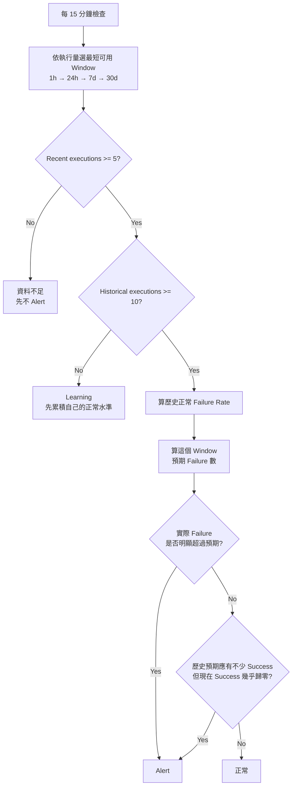
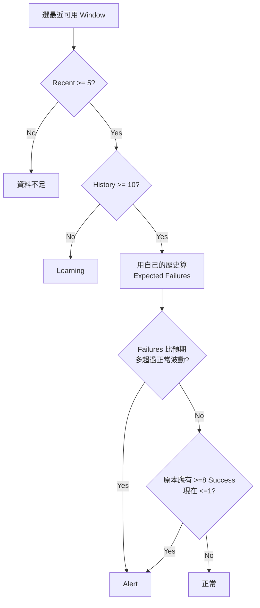

# 通用積木異常 Alert v9 — 簡單規則 + Python 驗證

> **目標**
>
> 用少量規則涵蓋：
>
> - 多樣本 / 少樣本
> - 有歷史 / 無歷史
> - 新積木 / 舊積木
> - 正常 Failure Rate 很低或高達 90% 的積木
> - 3～4 天才執行 1 次的極低流量積木
>
> 並避免：
>
> - 固定 `failure rate > 30%` 造成誤報
> - 正常 Failure Rate 90% 的積木永遠告警
> - 過度複雜的 High / Medium / Low 規則
>
> 本文件中的 A～J 情境都有使用 `simulate_alert.py` 實際驗證。

---

# Summary

## 1. 最終只留一個核心想法

**不要問 Failure Rate 高不高。**

改問：

> 依照「這顆積木自己的歷史」，現在這批 executions **理論上應該有多少 failures**？  
> 實際 failures 是否多到已經超過合理波動？

例如：

```text
Block A 平常 failure = 1%
100 executions 理論約 1 failure
現在 20 failures
→ 明顯異常

Block B 平常 failure = 90%
100 executions 理論約 90 failures
現在 91 failures
→ 正常

Block B 平常 failure = 90%
100 executions 現在 100 failures
→ 成功能力幾乎消失，可能異常
```

因此不需要所有積木共用固定 Failure Rate Threshold。

---

## 2. 整體流程



人只需要記：

```text
資料太少      → 不硬判
沒有歷史      → 自動 Learning
有歷史        → 跟自己比
Failure 比預期多很多 → Alert
Success 幾乎歸零     → Alert
```

---

# 3. Window 怎選

使用最短、但樣本夠用的 Window：

```text
1h 有 >=20 executions
→ 用 1h

否則 24h 有 >=20
→ 用 24h

否則 7d 有 >=20
→ 用 7d

否則 30d 有 >=5
→ 用 30d

30d 還 <5
→ 資料不足，不做 failure-rate anomaly alert
```

因此：

```text
高流量
→ 很快在 1h 判斷

一天幾筆
→ 自動拉到 24h / 7d

3~4 天才一筆
→ 30d 約可累積 7~10 筆
```

不用人工標記 High / Medium / Low。

---

# 4. 核心公式

## 4.1 歷史正常 Failure Rate

用 Laplace smoothing 避免少量歷史直接變成 0% 或 100%：

```text
normal_failure_rate
=
(history_fail + 1)
/
(history_exec + 2)
```

PromQL 概念：

```promql
(
  block:history_failure + 1
)
/
(
  block:history_execution + 2
)
```

---

## 4.2 預期 Failure 數

```text
expected_failure
=
recent_execution * normal_failure_rate
```

PromQL：

```promql
block:recent_execution
*
block:normal_failure_rate
```

---

## 4.3 允許的正常波動

為了同時考慮：

```text
近期 execution 自己的隨機波動
+
歷史 baseline 本身不是完全精準
```

使用：

```text
variance
=
n * p * (1-p)
+
n² * p * (1-p) / history_n
```

其中：

```text
n = recent execution
p = normal failure rate
history_n = historical execution
```

PromQL：

```promql
(
  block:recent_execution
  * block:normal_failure_rate
  * (1 - block:normal_failure_rate)
)
+
(
  block:recent_execution ^ 2
  * block:normal_failure_rate
  * (1 - block:normal_failure_rate)
  /
  block:history_execution
)
```

Prometheus 支援 `^`、`sqrt()` 與 subquery，可直接實作這類運算。

---

## 4.4 Alert Threshold

```text
allowance
=
max(
    最少多出 3~4 個 failures,
    3.1 * sqrt(variance)
)
```

為降低小樣本誤報：

```text
recent_exec < 20
→ 至少要比預期多 4 failures

recent_exec >= 20
→ 至少要比預期多 3 failures
```

Alert：

```text
actual_failure - expected_failure
>=
allowance
```

這條就是主要 Alert Rule。

---

# 5. 高 Failure Rate 保護

如果某積木：

```text
平常 failure = 90%
```

Failure Rate 從：

```text
90% → 91%
```

不該 Alert。

但是：

```text
90% → 100%
```

代表原本約 10% 的成功能力消失。

因此補一個非常簡單的條件：

```text
如果歷史推算這個 Window 原本應該至少成功 8 次
但現在實際只成功 0~1 次
→ Alert
```

公式：

```text
expected_success
=
recent_exec * (1 - normal_failure_rate)

actual_success
=
recent_exec - recent_failure
```

PromQL：

```promql
(
  block:recent_execution
  * (1 - block:normal_failure_rate)
) >= 8
and
(
  block:recent_execution
  - block:recent_failure
) <= 1
```

這條專門防止：

```text
正常 Failure Rate 已經很高
→ 普通 Failure anomaly score 不夠敏感
→ 真正 Success Collapse 被漏掉
```

---

# 6. 情境 A — 平常 Failure 很低，而且現在正常

```text
History:
1000 exec / 10 fail
≈ 1%

Recent:
100 exec / 1 fail
≈ 1%
```

預期：

```text
OK
```

Python：

```text
PASS
```

---

# 7. 情境 B — 平常 Failure 很低，突然變很差

```text
History:
1000 / 10
≈ 1%

Recent:
100 / 20
= 20%
```

預期：

```text
ALERT
```

Python：

```text
PASS
```

---

# 8. 情境 C — 平常 Failure 就是 90%

```text
History:
1000 / 900
= 90%

Recent:
100 / 91
= 91%
```

雖然絕對 Failure Rate 很高，但它跟自己平常差不多。

預期：

```text
OK
```

Python：

```text
PASS
```

---

# 9. 情境 D — 平常 90%，但成功能力消失

```text
History:
90% failure
≈ 10% success

Recent:
100 exec
100 fail
0 success
```

歷史本來預期：

```text
約 10 次 success
```

實際：

```text
0
```

預期：

```text
ALERT
```

Python：

```text
PASS
```

---

# 10. 情境 E — 少樣本 + 平常 Failure 90%

```text
History:
90% failure

Recent:
5 exec
5 fail
```

5/5 雖然是 100%，但對原本 90% Failure 的積木並沒有足夠證據證明異常。

預期：

```text
OK
```

Python：

```text
PASS
```

---

# 11. 情境 F — 少樣本，但真的遠離歷史

```text
History:
100 exec / 10 fail
= 10%

Recent:
5 exec / 5 fail
= 100%
```

即使只有 5 筆，這跟 10% baseline 差距已非常大。

預期：

```text
ALERT
```

Python：

```text
PASS
```

---

# 12. 情境 G — 中等 Failure Rate，現在正常

```text
History:
200 / 40
= 20%

Recent:
20 / 4
= 20%
```

預期：

```text
OK
```

Python：

```text
PASS
```

---

# 13. 情境 H — 中等 Failure Rate，突然惡化

```text
History:
20%

Recent:
20 exec / 12 fail
= 60%
```

預期：

```text
ALERT
```

Python：

```text
PASS
```

---

# 14. 情境 I — 新積木完全沒有歷史

```text
History:
0

Recent:
100 exec / 80 fail
```

這裡不能通用地說 80% 一定異常，因為系統已知確實可能存在正常 Failure Rate 90% 的積木。

因此：

```text
LEARNING
```

而不是：

```text
直接 Alert
```

這是刻意避免 false alert。

高流量新積木會很快累積 baseline；
極低流量新積木則必然需要更久。

Python：

```text
PASS
```

---

# 15. 情境 J — 3~4 天才一筆

例如目前 30 天只有：

```text
3 executions
2 failures
```

只有 3 筆仍太少。

預期：

```text
INSUFFICIENT
```

規則會繼續累積：

```text
30d >= 5 executions
```

才開始做統計判斷。

Python：

```text
PASS
```

> 如果某積木固定 3~4 天才一次，30 天大約只有 7~10 筆；  
> 可以判斷非常劇烈的變化，但不可能像高流量積木一樣快速、精細。  
> 這是資料量本身的限制，不是 Prometheus Rule 能完全消除的問題。

---

# 16. Python 驗證結果

`simulate_alert.py` 做兩種測試：

```text
1. Deterministic
   → MD A~J 每個情境逐一驗證

2. Monte Carlo
   → 大量隨機產生正常 / 異常資料
   → 量 false positive 與 detection rate
```

實際結果請看：

```text
simulation_summary.md
deterministic_scenarios.csv
monte_carlo_results.csv
```

本次固定 Seed：

```text
20261026
```

因此可以重跑。

---

# 17. Monte Carlo 結論

本次測試涵蓋 baseline Failure Rate：

```text
0.1%
1%
5%
10%
30%
50%
90%
```

Recent sample：

```text
5
10
20
50
100
500
```

重點觀察：

```text
正常狀況的 false alert 整體偏低
正常 90% failure 的積木不會因為 failure rate 高就一直叫
90% → 100% 且樣本夠時可以抓到
樣本越少，規則刻意越保守
```

請以附帶 `simulation_summary.md` 的實際數字為準。

---

# 18. Prometheus Window Recording Rules

目前 Query Exporter 每 15 分鐘吐 rolling 1h Gauge。

基礎：

```yaml
- record: block:execution_1h
  expr: |
    sum by (block) (block_execution_1h)

- record: block:failure_1h
  expr: |
    sum by (block) (block_failure_1h)
```

24h：

```yaml
- record: block:execution_24h
  expr: |
    sum_over_time(
      (block:execution_1h)[24h:1h]
    )

- record: block:failure_24h
  expr: |
    sum_over_time(
      (block:failure_1h)[24h:1h]
    )
```

7d：

```yaml
- record: block:execution_7d
  expr: |
    sum_over_time(
      (block:execution_1h)[7d:1h]
    )

- record: block:failure_7d
  expr: |
    sum_over_time(
      (block:failure_1h)[7d:1h]
    )
```

30d：

```yaml
- record: block:execution_30d
  expr: |
    sum_over_time(
      (block:execution_1h)[30d:1h]
    )

- record: block:failure_30d
  expr: |
    sum_over_time(
      (block:failure_1h)[30d:1h]
    )
```

> 因來源是 rolling 1h Gauge，24h / 7d / 30d 是 reconstructed estimate。  
> 正式上線前必須用 DB 真實 count backtest。

---

# 19. Window Selection

邏輯：

```text
1h >=20
→ 1h

else 24h >=20
→ 24h

else 7d >=20
→ 7d

else 30d >=5
→ 30d

else
→ INSUFFICIENT
```

Prometheus Alert Rule 最容易維護的方式不是硬做「動態變數」，
而是寫 4 個 OR branch，四個 branch 共用完全相同的 anomaly formula。

---

# 20. History 怎取

History 必須：

```text
跟 Recent 不重疊
```

例如：

```text
1h recent
→ previous history offset 1h

24h recent
→ history offset 24h

7d recent
→ history offset 7d

30d recent
→ history offset 30d
```

而且：

```text
history_execution >= 10
```

才啟用 self-baseline 判斷。

對 3~4 天才一次的積木，
history window 建議拉長到：

```text
60~90 天
```

否則歷史本身也沒有足夠資料。

---

# 21. PromQL — Normal Failure Rate

假設已建立：

```text
block:history_execution
block:history_failure
```

則：

```yaml
- record: block:normal_failure_rate
  expr: |
    (
      block:history_failure + 1
    )
    /
    (
      block:history_execution + 2
    )
```

---

# 22. PromQL — Expected Failure

```yaml
- record: block:expected_failure
  expr: |
    block:recent_execution
    *
    block:normal_failure_rate
```

---

# 23. PromQL — Variance

```yaml
- record: block:failure_variance
  expr: |
    (
      block:recent_execution
      *
      block:normal_failure_rate
      *
      (1 - block:normal_failure_rate)
    )
    +
    (
      (block:recent_execution ^ 2)
      *
      block:normal_failure_rate
      *
      (1 - block:normal_failure_rate)
      /
      clamp_min(block:history_execution, 1)
    )
```

---

# 24. PromQL — 主要 Alert

對 `recent_exec >=20`：

```promql
(
  block:recent_failure
  -
  block:expected_failure
)
>=
clamp_min(
  3.1 * sqrt(block:failure_variance),
  3
)
```

對 `5 <= recent_exec <20`：

```promql
(
  block:recent_failure
  -
  block:expected_failure
)
>=
clamp_min(
  3.1 * sqrt(block:failure_variance),
  4
)
```

再要求：

```promql
block:history_execution >= 10
```

以及：

```promql
block:recent_execution >= 5
```

---

# 25. PromQL — Success Collapse

```promql
(
  block:recent_execution
  *
  (1 - block:normal_failure_rate)
) >= 8
and on(block)
(
  block:recent_execution
  -
  block:recent_failure
) <= 1
```

最後：

```text
Alert =
Unexpected Extra Failures
OR
Success Collapse
```

---

# 26. 最後的簡化架構



這版沒有：

```text
固定 10% / 30% / 50% failure threshold
人工 High / Medium / Low 分類
新積木特別名單
```

只依：

```text
自己的歷史
目前樣本量
現在比預期多多少 Failure
```

---

# 27. 重要限制

如果：

```text
新積木
沒有任何歷史
只有 1 execution
而且失敗
```

在已知「某些合法積木平常 failure 就可能 90%」的前提下，

**沒有任何通用統計方法能同時保證：**

```text
這時一定 Alert
AND
不誤報正常高 Failure Block
```

所以 v9 明確選擇：

```text
少樣本 / 無歷史
→ 保守 Learning
→ 不猜
```

這是降低 false alert 必須付出的代價。

---

# 28. 建議 Production v1

先採這版：

```text
Window:
1h / 24h / 7d / 30d

Recent min:
5

History min:
10

統計門檻:
3.1 sigma

最低 Excess Failures:
recent <20  → 4
recent >=20 → 3

High-normal-failure 保護:
expected success >=8
actual success <=1
```

然後用真實 production DB：

```text
30~90 天
```

再跑一次 backtest。

Python 模擬證明這個方向在不同 baseline failure rate 下具有不錯的 false-positive / detection trade-off，
但正式 threshold 最後仍應由你的真實資料校正。
